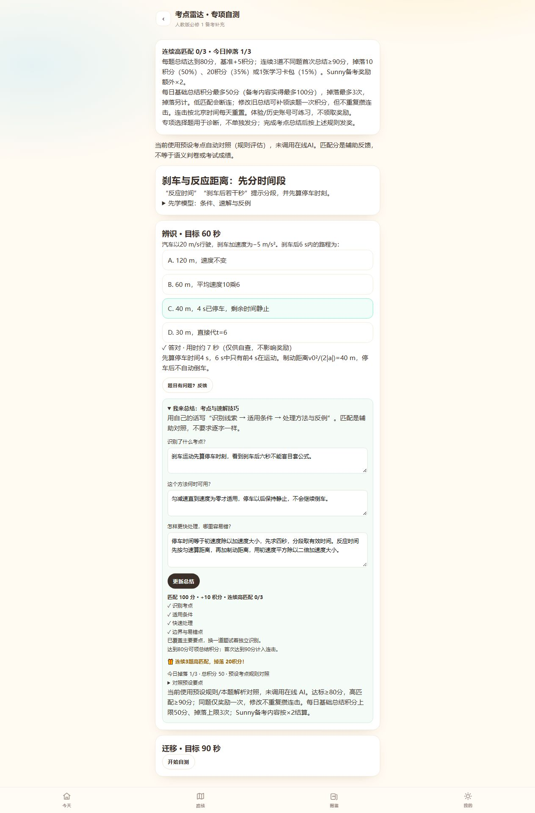

# 考点雷达与逐题总结（2026-11-15）

目标是帮助 Sunny 看到题干就识别模型，先检查条件，再选最短路径。首页备考卡和路线页新增「考点雷达」入口。建议每天练 2–3 类，先自测，再写自己的总结，隔天回顾容易漏掉的条件。

## 内容与训练

共 18 类、36 道题，每类各一道辨识题和迁移题。自测参考用时 60/90 秒，仅用于自查，不影响奖励。题目前可展开适用条件、速解和反例；判分后展示解析与总结入口。专项独立记录已作答数，不并入已有 86 个备考单元的通关进度，选择题本身不另发分。

| 学科 | 专项 |
| --- | --- |
| 物理 7 类 | 轻绳等张力、动滑轮数绳段、静摩擦需要值与上限、整体与隔离、超失重、刹车分段与反应距离、v-t 图像 |
| 数学 5 类 | 对数定义域、底数与不等号方向、换底与同值设等、恒过定点、三角函数定号与诱导 |
| 化学 6 类 | 22.4 的条件、浓度分母、限量试剂、离子方程式、氧化还原电子守恒、等电子粒子 |

特别修正「绳被拉时处处等张力」的无条件表述：同一根绷紧轻绳、理想滑轮且忽略质量和摩擦时才可直接使用等张力。有质量的竖绳、带摩擦的滑轮须另作分析；张力相等也不意味着张力等于悬挂物重力。

新题答案 A/B/C/D 各 9 道。迁移题要求检查边界、分段或联立关系；本轮重点是考点辨识训练，不声称全部为高难压轴题，也没有学生实测速度提升数据。具体教材范围延续现有必修 1 备考映射，配合学校实际进度使用。

## 总结与奖励

实际作答后，每题可填写「识别考点、适用条件、快速处理与易错点」三部分。原题的快速测试、闯关、误区题、分步题、Boss，以及错题本原题重做均接入。已保存的总结可在原题页刷新后继续查看和修改。

- 80 分及以上：每道不同题仅一次基准 5 积分，Sunny 活动期备考范围为 10 积分。
- 连续 3 道不同题的**首次总结**达 90 分及以上：随机掉落 10 积分（50%）、20 积分（35%）、1 学习卡包（15%）。按第三题所属备考范围结算 Sunny ×2，即 20/40 积分或 2 学习卡包。学习卡包与盲盒券独立。
- 首次总结低于 90 分会断连；修改旧总结可补领本题积分，不再次增加或重算连击。跨题完全相同总结不领奖、不攒连击。
- 每日基础总结积分上限 50，全部为 Sunny 备考内容时实得最多 100；掉落另计，每日最多 3 次。连击按北京时间每天重置。
- 正式 active 账号可领取；访客、历史账号可练习。按真实账号身份和服务器日期结算，不按昵称或客户端参数。

题目指纹忽略题号、位置、解析编辑及选项重排；用户与题目联合唯一。事务、请求重放和奖励事件共同防止刷新、重复点击和并发重复发奖。首次作答凭据、评分及奖励由服务器保存。新增三张表，schema 13，不追溯为旧作答补发奖励。

## 评分的实际能力

遵守此前「AI 暂不开放」要求：**未调用在线 AI**。新专项采用逐类预设规则，按识别考点 20、适用条件 30、快速处理 30、边界与易错点 20 评分，检查部分常见错误结论。存量题使用本题 skill/解析的字面要点覆盖对照。

这不是完整语义判卷。同义改写可能被低估，堆关键词也可能被高估；高匹配不等于总结一定正确或考试成绩。页面明确标注评分方式，显示命中项、遗漏项、可检测的矛盾和参考要点。建议家长结合真实总结抽查，再决定是否接入在线语义评估。

## 验证

完整回归：358 个 pytest 用例和 216 个子测试通过；新增 35 个用例覆盖内容完整性、答案不泄漏、18 类预设、同义表达和错误条件、实际作答与用户隔离、重复与并发提交、每日额度与跨日、三连随机掉落、过期倍率、原题/错题本入口、反馈和限流。24 个前端模块语法/import 检查、原题库结构检查、git diff --check 通过。

全量运行出现既有 Starlette 弃用提示及 Windows GBK 子进程解码警告；后者对应的生成器可重放测试在 PYTHONUTF8=1 下单独复测通过，仅剩弃用提示。

隔离数据库的浏览器实测：从首页进入专项，完成刹车辨识题，自写总结获 100 分和 10 积分；以预置 2/3 连击验证第三题实际随机掉落 20 积分、连击归零，刷新后总结和最佳分恢复。测试总积分为 50，与真实 Sunny 余额无关。未使用真实账号作答、签到或抽卡。

## 发布结果

待上线后补充运行版本、数据保持比对及双入口验证结果。
