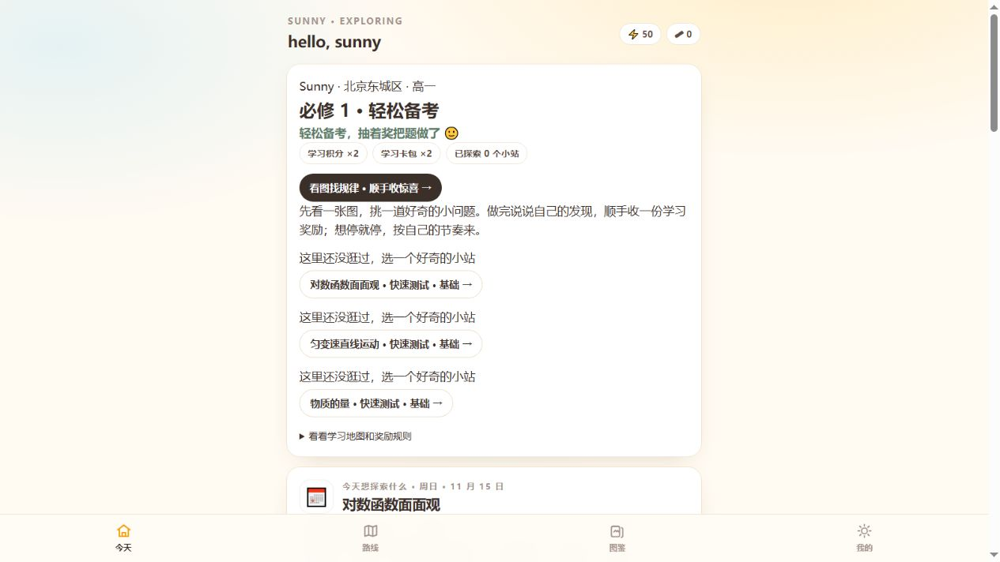
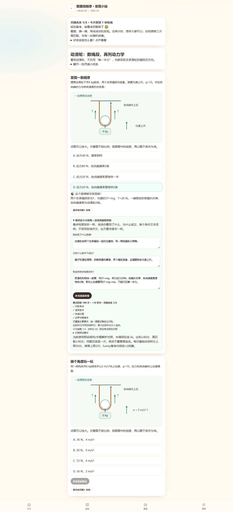

# 轻松备考，抽着奖把题做了 🙂

## 体验调整

首页学习卡改为「必修 1 · 轻松备考」，突出用户指定的主旋律。移除考试日期/剩余天数行、待完成总数压力，改为「已探索 X 个小站」。推荐文案从清理错题、完成未通关单元，改为和老朋友再见面、挑一个好奇的小站；阶段提示也改成随时可停、慢慢发现，不催促每日时长或限时训练。

「考点雷达」改成「看图找规律 · 发现小站」。目标 60/90 秒、计时器逻辑、判分后的答题用时和配置中的 target_seconds 均移除。题目直接展开；先看图、猜一猜，再看看自己的想法。学习卡的推荐时长和首页主题总时长不再向活动中的 Sunny 展示。原站其他主题页的阅读时长估计不属于答题计时，本轮未作全站清除。

奖励规则收进可展开的说明；「灵感连连」「收好这个小发现」替代专项页面的考试/诊断语气。实际积分、匹配门槛、随机概率、每日额度与三题高匹配条件沿用上一轮规则，在线 AI 继续关闭。用语变化不声称规则对照具备真正语义理解。

## SVG 图解

36 道专项题逐题配图，位于 `web/diagrams/discoveries/`，对应题目中显示，可点开放大。为轻绳/有质量绳、动滑轮、静摩擦、整体隔离、电梯、小车、v-t 图像、对数、三角函数、溶液、分子、离子与电子关系提供线索。

图解聚焦物理情境、坐标和关系，而非直接给出数值选项。所有图带替代文字、标题和说明；按页面宽度等比缩放。函数图采用统一的数学坐标映射；v-t 图中斜线、刻度与正负面积共用坐标。气体题分子比例与给定 25% 的 O₂ 对齐；最终溶液体积未知时标为 V=?；等电子粒子图明确圆圈不代表实际半径。图注说明示意图不按比例，题干条件优先。

图为本站原创 SVG，无外部脚本、远程资源或嵌入图片。生成器 `tools/build_exploration_diagrams.py` 可重放 36 张图，并用 `--check` 验证 XML、题目引用和生成产物。现有普通题库仍使用原来的图解，本轮新图覆盖全部 36 道专项题。

## 验证

相关 85 项回归用例分别通过；首次运行仅一项推荐理由的旧文案断言失败，更新为新的温和文案后，学习计划 29 项复测通过。奖励、连击、原题、反馈与账号隔离相关用例通过。24 个前端模块语法和相对 import、原题库结构、36 张 SVG 的 XML/配置/可重放检查、git diff --check 通过。

逐题比较上一版配置，题干、选项、正确答案、评分预设、矛盾规则和奖励概率完全一致；新增插图、删除目标秒数不改变题目奖励指纹。备考范围、活动起止和积分/卡包倍率也未改动。

浏览器逐组目视检查 36 张图，36/36 正常加载；检查首页无倒计时、奖励规则折叠、专项插图、点图放大/关闭、作答结果无用时。使用隔离测试账号完成一道动滑轮题，总结 100 分、+10 积分，页面连击计数同步更新；没有对真实 Sunny 作答或抽奖。

## 发布结果

运行版本：`312dc5269ef143ad2779c7a6a498807e6cc9f032`，已推送 Gitee master 和 codex/relaxed-visual-learning。以 97d11b8 为基线比较线上文件，更新 44 个运行文件（包含 36 张 SVG），文件哈希全部匹配发布包。

备份：`/var/backups/learning-highschool/relaxed-pre-312dc52-20261115-125611`，包含完整数据库、旧代码和业务表摘要。停服更新前后，原有全部 17 张业务表的全部列/行摘要完全一致，包括 users、progress、events、question_attempts、question_reflections、reflection_state 等；schema 保持 13，数据库完整性和外键检查通过。

主站 `https://123-56-217-104.sslip.io/` 与 `https://123.56.217.104.sslip.io:8090/` 的健康检查、全部公开 JS/SVG 哈希和未登录专项 API 认证保护检查均通过。服务端只读验证 18 类/36 题均有插图且无目标秒数字段，18 类预设可用，Sunny 活动倍率仍为 2、原进度仍为 5/86。未使用真实账号作答、签到或抽奖，未修改 AI、systemd 或代理配置。隔离本地预览已关闭。
