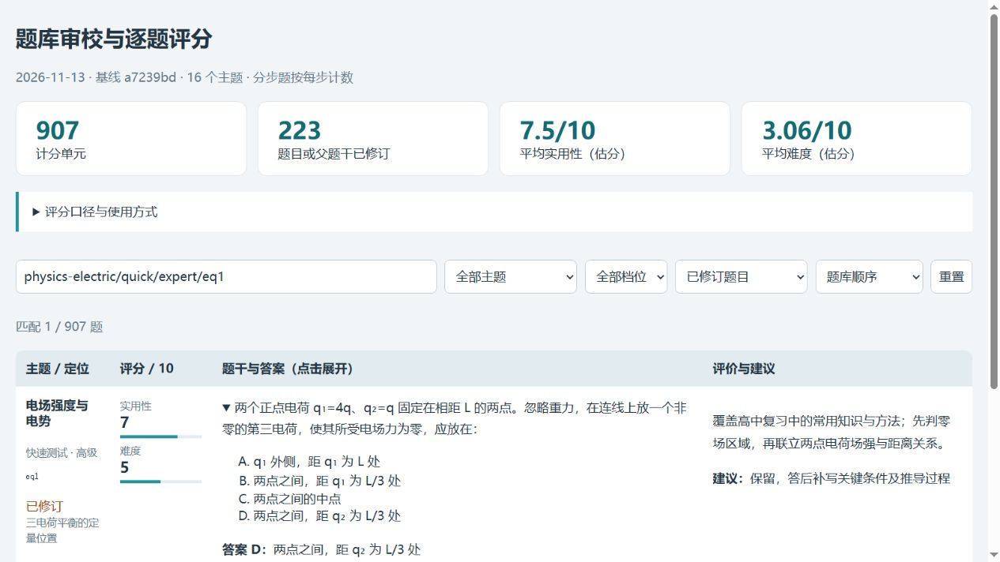

# 2026-11-13 题库审校验证记录

同步基线：`b394d2f → a7239bd`，从 Gitee `origin/master` 拉取6个提交并快进合并。本轮修订留在本地工作区，未提交、推送或部署。线上服务与真实用户数据库未修改。

## 覆盖与方法

内容审阅覆盖16个主题、907个计分单元。分步题每步算一个单元；阅读不计题数。包含190个作答单元与38个阅读单元，共228个学习单元。

作答接口回归在临时SQLite数据库运行：每个作答单元各提交一次全错答案及一次全对答案，核对题量、逐题明细、0/100分与通过状态；38个阅读单元逐个确认完成；全部228个单元检查公开内容不含答案及解析字段。此验证检查判分、接口和答案配置的一致性，不能替代学科正确性审阅。

分步练习全错也会完成，符合当前“全部作答即完成”的设计，其余题型按各自正确率门槛通过。本轮没有改动这一学习进度规则。

## 自动检查

|检查|结果|
|---|---|
|`.venv/Scripts/python.exe -m pytest tests -q`|139 passed，204 subtests passed|
|`.venv/Scripts/python.exe tools/check_content.py`|16主题907题、20张卡片，通过|
|`node tools/check_frontend.mjs .`|14个模块全部通过|
|生成报告的内嵌JavaScript `node --check`|通过|
|评分数据检查|907个唯一定位，评分均在1–10，96个逐题覆盖评分定位全部存在|
|`git diff --check`|通过|

测试环境有一条Starlette关于httpx测试客户端的弃用警告，不影响本轮测试结果。最终前端按钮修复还通过浏览器操作复验与前端检查；后端测试后仅追加了配套教学文案修订，未改题目答案或判分逻辑。

## 浏览器实际走查

本地网站运行在`127.0.0.1:8011`，数据库为独立的`.zcode/review-app.db`。使用专用reviewer测试账号。

|流程|观察结果|
|---|---|
|登录与主题路线|登录成功；运动学从错误的85题修正为82题，阅读显示“阅读总结”|
|快速测试|5题提交，故意错1题，80分，解析正确并自动收进错题本|
|基础闯关|首关3题全对，100分并解锁第2关；第2关加载正常|
|知识总结|确认阅读成功；修订后显示“阅读已完成 / 复习完成”，不显示答题数|
|难点剖析|复现提交按钮无法启用；修复后3题选完即可提交，得到100分及逐题解析|
|分步巩固|8步全对提交，100分，显示完整解题链及每步解析|
|Boss|单题全对，100分，显示+50积分、+1卡包及彩蛋|
|错题重做|错题自动收录；重做答对显示1/1清零、+20积分|
|评分报告|显示907题、223个修订单元；“已修订”筛选223题；按完整定位搜索得到1题；展开显示正确选项及解析|

网页抽查以运动学主题覆盖六种界面，接口回归覆盖全部16主题及全部档位；并非逐个在浏览器点击907题。AI错题分析因本地未配置服务密钥而未验证，错题收录、重做和清零不依赖它。

## 交付

- [逐题评分报告](question-review-2026-11-13.html)
- [评分摘要](question-review-2026-11-13.md)
- [907题完整评分数据](question-review-2026-11-13.json)
- [逐项修订记录](question-review-2026-11-13-changes.json)

评分为AI内容审阅后的规则估计，另有96个逐题覆盖评分；没有使用学生实际正确率、用时或区分度。数据记录源文件SHA-256，便于确认报告对应的题库版本。

